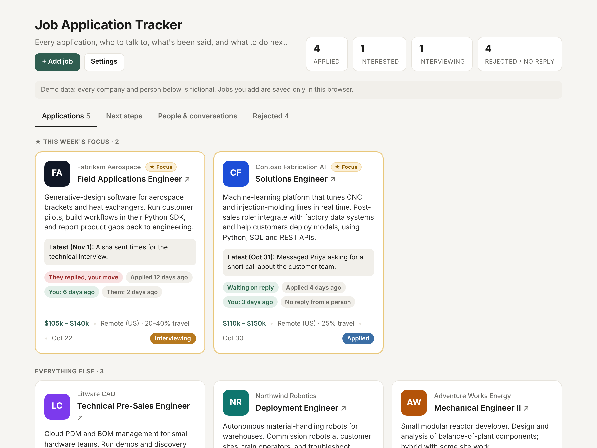
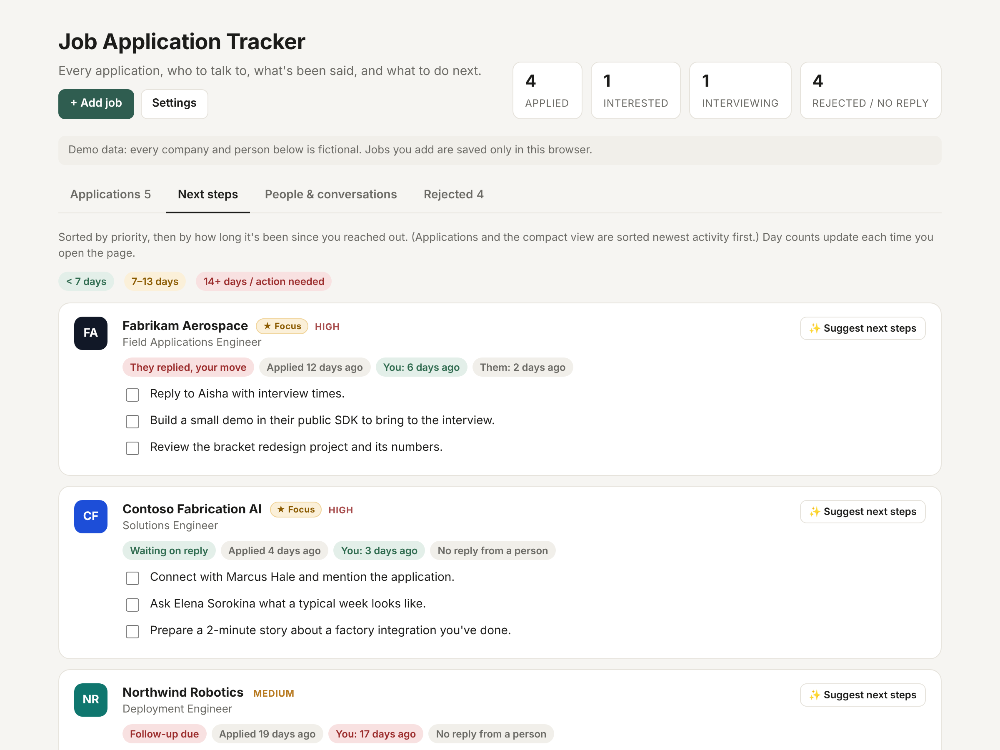

# Job Application Tracker

**A job-search dashboard I built and used daily during my own search, with Claude built in to do the busywork.**

It tracks each application, the people worth talking to at each company, the full conversation history, and what to do next. It also flags which threads have gone cold.

**[Try the live demo →](https://dzavrack.github.io/job-application-tracker/)** It has fictional data, and the Claude features work with your own API key.



> The data in this repo is fictional demo data. My real tracker runs on the same code with my own applications.

## What it does

- **Applications.** One card per job with pay, location, latest activity and status. "This week's focus" jobs are pinned to the top.
- **Timing chips.** "They replied, your move", "Follow-up due" or "Waiting on reply", plus day counters for you and them. These are computed from the conversation log every time the page opens.
- **Next steps.** A prioritized checklist per application, sorted by priority and then by how long it's been since you reached out.
- **People & conversations.** Contacts at each company (connection degree, contacted or not) next to a timeline of every email and message.
- **Automatic no-reply rule.** An application with no reply from a person after 30 days moves to the Rejected tab by itself.

## Claude features

| Feature | What happens |
|---|---|
| **+ Add job** | Paste a raw job posting. Claude extracts the company, title, pay range, location and a two-line summary, picks a monogram and color, and suggests first steps. The result becomes a new card. |
| **✨ Suggest next steps** | Claude reads that application's status, contacts and conversation history (with day counts) and writes 1–4 concrete next actions, following normal follow-up etiquette. |



**How it's built:**
- Both features use **tool use with a forced `tool_choice`**. Claude has to answer by "calling" a tool whose JSON schema matches the tracker's data model, so the app gets clean structured data instead of free text it would have to parse (`claude.js`).
- The next-steps prompt is restricted to the facts it's given ("never invent contacts or events"). That matters when the output is about real people.
- No backend. The browser calls the Anthropic API directly with your own key, which stays in `localStorage`. Jobs you add and Claude's suggestions are saved in the browser too, and can be exported as JSON from Settings.

## Run it

Use the [live demo](https://dzavrack.github.io/job-application-tracker/), or open `index.html` in a browser; nothing to install. To use the Claude features, click **Settings** and paste an [Anthropic API key](https://console.anthropic.com/).

To track your own search, replace the sample data in `data.js`, or start adding jobs with **+ Add job**.

## Files

```
index.html   layout and dialogs
style.css    styling (light and dark mode)
app.js       data model, timing rules, and the four views
claude.js    Claude API calls, tool schemas, add-job and next-steps features
data.js      fictional sample data (dates are relative to today)
docs/        screenshots
```

## Background

I started this as a running log while searching for a solutions/field engineering role. Over a few weeks it grew into the tool I checked every morning. The original version was maintained with Claude reading my email and LinkedIn messages; this public version keeps the same interface and swaps in demo data and in-app Claude features that anyone can use with their own key.
